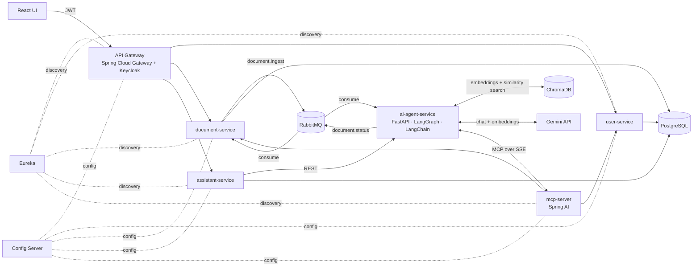
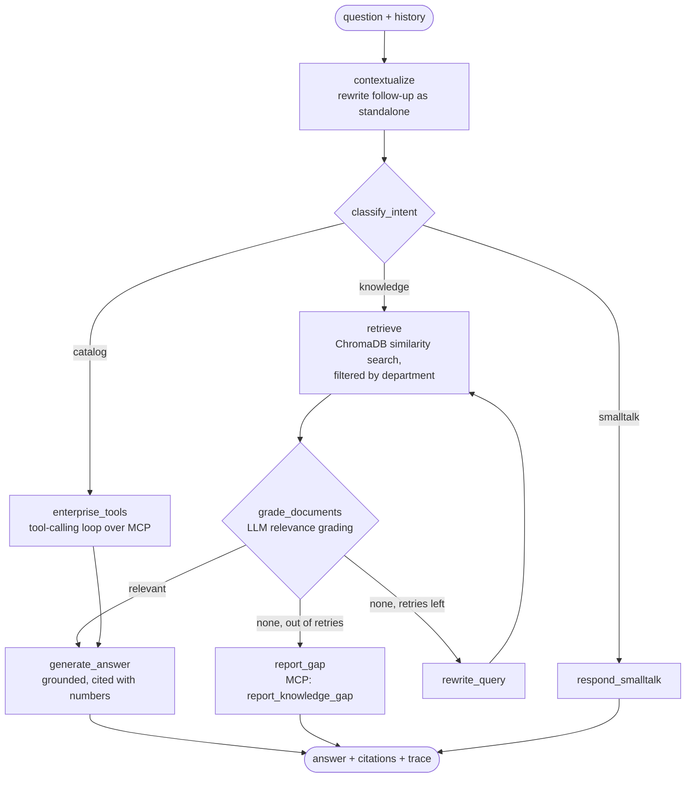

# Enterprise AI Knowledge Assistant

An enterprise knowledge assistant that answers employee questions from company documents. **Spring Boot microservices** handle identity, documents and conversations. A **LangGraph** agent does the reasoning, using **Retrieval-Augmented Generation (RAG)** over **ChromaDB** with **Gemini**. The agent reaches enterprise systems as tools over the **Model Context Protocol (MCP)**, and document ingestion runs asynchronously over **RabbitMQ**.

**Stack:** Java 21 · Spring Boot 3.5 · Spring Cloud (Gateway, Eureka, Config) · Spring AI MCP Server · Python · LangChain · LangGraph · Gemini API · ChromaDB · RabbitMQ · PostgreSQL · Keycloak · React

---

## Architecture



### Services

| Service | Tech | Responsibility |
|---|---|---|
| `api-gateway` | Spring Cloud Gateway, OAuth2 Resource Server | Validates Keycloak JWTs. Strips spoofed identity headers, then forwards `X-User-ID` / `X-User-Department` taken from the token. Auto-provisions users on first login. |
| `user-service` | Spring Boot, JPA, PostgreSQL | User directory mirrored from Keycloak (name, email, department, role). |
| `document-service` | Spring Boot, JPA, Apache Tika, RabbitMQ | Uploads files (PDF, DOCX, PPTX, HTML, MD, TXT…) and extracts their text. Keeps document metadata and department-level visibility. Publishes ingestion events and applies the indexing status that comes back. Tracks knowledge gaps. |
| `assistant-service` | Spring Boot, JPA, WebClient | Conversations and message history. Sends the question, recent history and the user's department to the agent, then stores the answer with its citations, tool calls and reasoning trace. |
| `mcp-server` | Spring AI MCP Server (WebMVC, SSE) | Publishes enterprise back-ends as standard MCP tools, found through Eureka: document catalog, user directory and knowledge-gap tracker. |
| `ai-agent-service` | Python, FastAPI, LangGraph, LangChain, ChromaDB, Gemini | The RAG agent. It also consumes ingestion events to chunk, embed and index documents. |
| `eureka-server` / `config-server` | Spring Cloud | Service discovery and centralised configuration. |
| `frontend` | React, Vite, MUI | Chat with inline citations and an expandable agent trace, a document library and a knowledge-gap queue. |

---

## How a question is answered: the LangGraph workflow



* **Multi-step reasoning.** Follow-ups are made standalone using conversation memory. Retrieved chunks are graded for relevance. When nothing relevant is found, the agent rewrites its query (corrective RAG, at most `MAX_QUERY_REWRITES` times) before giving up.
* **Grounded answers.** The model may answer only from the numbered context and must cite it as `[n]`. Only the sources it actually cited are returned as citations.
* **Access control.** Each chunk carries its document's department in metadata. Retrieval returns only the caller's department plus company-wide (`ALL`) documents. In MCP calls, the agent always overwrites `userId` / `department` with the caller's own values, so the model cannot query on someone else's behalf.
* **Knowledge gaps.** Unanswerable questions are reported through an MCP tool and appear in the UI for document owners.
* **Graceful degradation.** If the MCP server is unreachable, retrieval still works, and the agent reports that tools are unavailable instead of failing.

## Document ingestion pipeline (RabbitMQ)

1. `POST /api/documents` (multipart). document-service extracts text with Apache Tika, stores the file and metadata (status `PROCESSING`) and publishes a `DocumentIngestionEvent` to `knowledge.exchange` with routing key `document.ingest`.
2. ai-agent-service consumes `document.ingest.queue`. It splits the text with LangChain's `RecursiveCharacterTextSplitter`, embeds the chunks with Gemini embeddings and upserts them into ChromaDB with IDs of the form `documentId:chunkIndex`, so re-indexing replaces the old chunks. Malformed messages go to a dead-letter queue.
3. The agent publishes `document.status` (`INDEXED` with a chunk count, or `FAILED` with the error). document-service consumes it and updates the document.
4. Deleting a document publishes `document.delete`, and the agent removes its vectors.

## MCP tools exposed by `mcp-server`

| Tool | Backend |
|---|---|
| `search_document_catalog(query, department)` | document-service |
| `get_document_details(documentId, department)` | document-service |
| `get_knowledge_base_stats()` | document-service |
| `get_user_profile(userId)` | user-service |
| `find_users_by_department(department)` | user-service |
| `report_knowledge_gap(question, userId, reason)` | document-service |
| `list_open_knowledge_gaps(limit)` | document-service |

The agent discovers these at runtime with `langchain-mcp-adapters`, so a new `@Tool` method in the Spring service becomes available to the agent without any change to the Python code. Any other MCP client (Claude Desktop, IDE agents) can use the same endpoint: `http://localhost:8090/sse`.

---

## Running it

### Everything with Docker

```bash
cp .env.example .env          # set GEMINI_API_KEY, or LLM_PROVIDER=fake to run offline
docker compose up --build
```

| URL | What |
|---|---|
| http://localhost:3000 | UI. Sign in as `alice` / `password` (HR) or `bob` / `password` (ENGINEERING) |
| http://localhost:8080 | API gateway |
| http://localhost:8761 | Eureka dashboard |
| http://localhost:15672 | RabbitMQ console (`guest` / `guest`) |
| http://localhost:8181 | Keycloak admin (`admin` / `admin`) |
| http://localhost:8000/docs | Agent service OpenAPI |

### Local development

Start the infrastructure (`docker compose up postgres rabbitmq chromadb keycloak`), then the services in this order: `eureka-server`, `config-server`, then the rest (`./mvnw spring-boot:run` in each folder). Then:

```bash
cd ai-agent-service
python -m venv .venv && source .venv/bin/activate
pip install -r requirements-dev.txt
cp .env.example .env && uvicorn app.main:app --reload --port 8000

cd frontend && npm install && npm run dev    # http://localhost:5173
```

### Try the agent without any infrastructure

```bash
cd ai-agent-service
LLM_PROVIDER=fake CHROMA_MODE=memory RABBITMQ_ENABLED=false MCP_ENABLED=false uvicorn app.main:app --port 8000
curl -X POST localhost:8000/knowledge/index -H 'content-type: application/json' \
  -d '{"documentId":"d1","title":"Travel Policy","content":"Receipts are required for any claim above 25 USD."}'
curl -X POST localhost:8000/agent/invoke -H 'content-type: application/json' \
  -d '{"question":"Do I need receipts for travel claims?","userId":"u1"}'
```

## API (through the gateway, with a Bearer token)

| Method | Path | Purpose |
|---|---|---|
| `POST` | `/api/chat/ask` | `{question, conversationId?}` → question, answer, citations, tool calls, trace |
| `GET` | `/api/chat/conversations` | The caller's conversations |
| `GET` | `/api/chat/conversations/{id}/messages` | Full history |
| `POST` | `/api/documents` | Multipart upload (`file`, `title`, `tags`, `department=ALL` to share company-wide) |
| `GET` | `/api/documents?q=` | Catalog search, scoped to the caller's department |
| `POST` | `/api/documents/{id}/reindex` | Re-run ingestion |
| `DELETE` | `/api/documents/{id}` | Uploader only; also removes the vectors |
| `GET` | `/api/knowledge-gaps?status=OPEN` | Unanswered questions |
| `GET` | `/api/users/me` | The caller's profile |

## Tests

```bash
mvn verify                                   # all Spring Boot services (H2 + mocked brokers)
cd ai-agent-service && pytest -q             # 20 tests: retrieval, LangGraph routing, ingestion, HTTP API, real MCP stdio round trip
cd frontend && npm run lint && npm run build
```

The Python tests run fully offline. A rule-based fake chat model and a hashing embedding stand in for Gemini, so every graph path (retrieve → grade → generate, rewrite → gap report, MCP tool calling, department scoping) is checked deterministically. One test starts a real MCP server process and lets the agent discover its tools and call them over the protocol. GitHub Actions runs all three suites on every push.

## Repository layout

```
api-gateway/         Spring Cloud Gateway + Keycloak JWT + identity propagation
config-server/       Spring Cloud Config (native) — all service configuration lives here
eureka-server/       Service discovery
user-service/        User directory (PostgreSQL)
document-service/    Upload, Tika extraction, RabbitMQ ingestion, knowledge gaps (PostgreSQL)
assistant-service/   Conversations, history, agent orchestration (PostgreSQL)
mcp-server/          Spring AI MCP server exposing enterprise tools
ai-agent-service/    LangGraph agent, LangChain + ChromaDB RAG, Gemini, MCP client, RabbitMQ consumer
frontend/            React UI
infra/               Postgres init script, Keycloak realm with demo users
```
